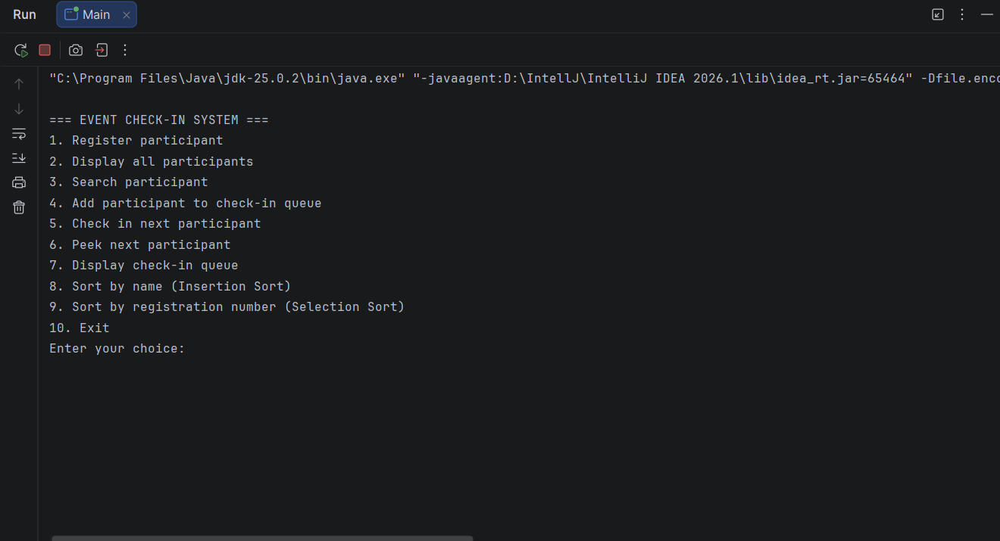
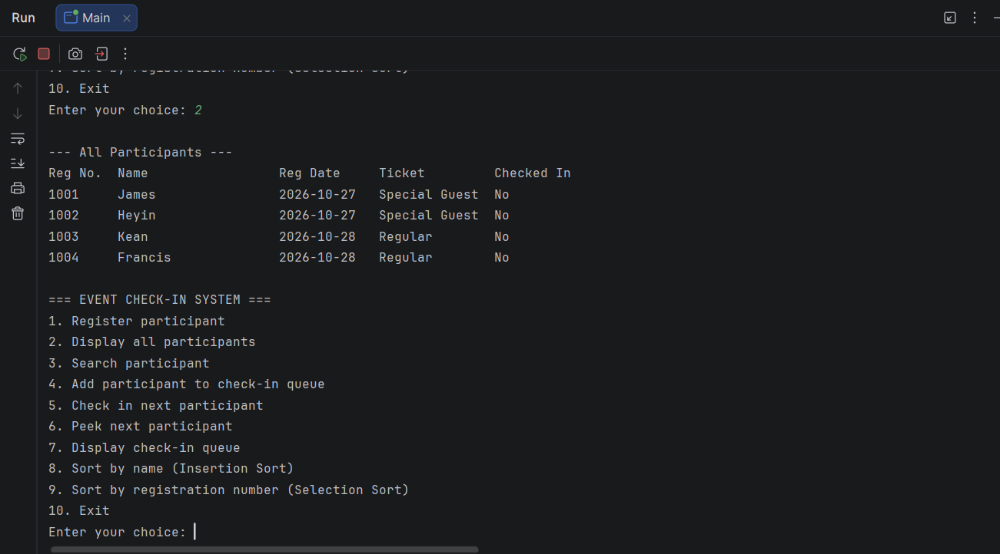
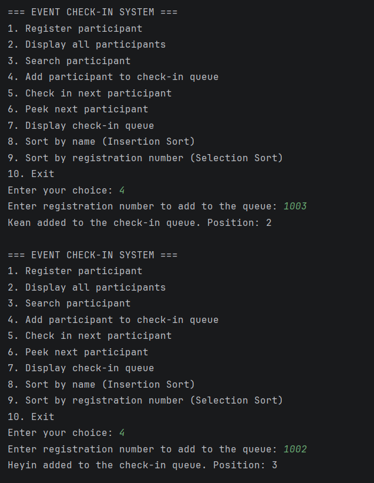
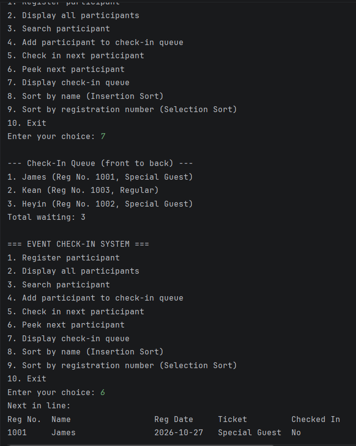
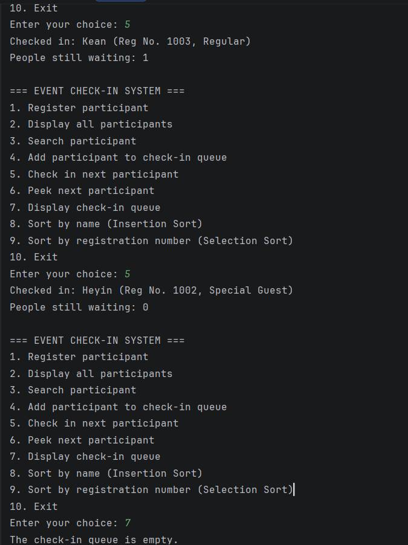
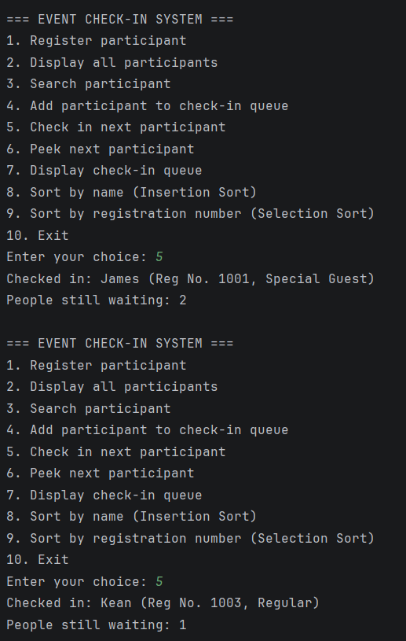
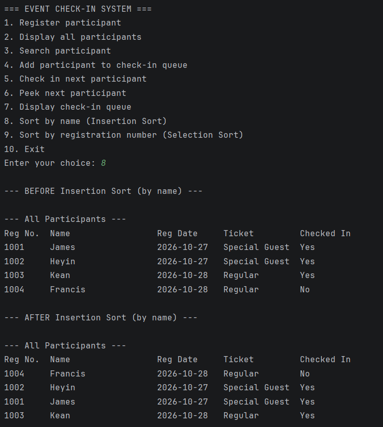
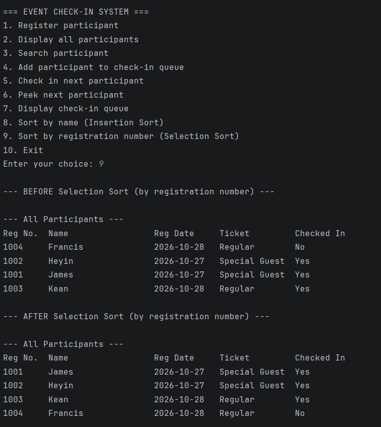
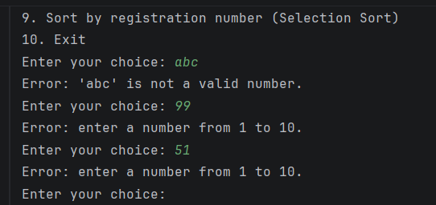
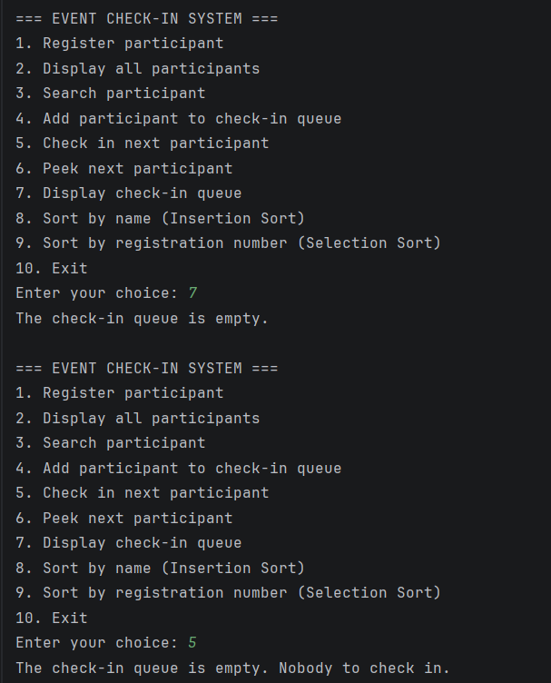

# Event Registration and Check-In System
Hale Justine S. Mendoza
BSIT | IT2A

## Project Description
A console-based Java application that manages participants arriving at an event. Organizers register participants, add them to a check-in line, and check them in one at a time. Without a system like this, check-in at an event can become disorganized: people are served out of order, records are hard to find, and it is unclear who has already arrived.

This program solves that by combining two ideas:
- A **queue** keeps the check-in line fair, so participants are checked in in the order they joined the line (First-In, First-Out).
- **Sorting algorithms** organize the participant records so they can be reviewed by name or by registration number.

The program is written without object-oriented programming. It uses only the `main` method, `static` methods, loops, conditionals, ArrayLists, and a Java `Queue`.

## Objectives
- Register and store participant records using ArrayLists.
- Manage the check-in line using a FIFO queue.
- Organize records using two manually implemented sorting algorithms.
- Search for participants by registration number or by name.
- Validate user input so the program never crashes on invalid entries.
- Display clear messages for empty lists, empty queues, and missing records.

## Use Cases and Features
| Menu Option | Feature | Description |
|---|---|---|
| 1 | Register participant | Enter a name, registration date, and ticket type (Regular or Special Guest). A unique registration number is generated automatically, starting at 1001. |
| 2 | Display all participants | Shows every record in a table, including whether the participant has checked in. |
| 3 | Search participant | Find a participant by exact registration number, or by full or partial name (not case sensitive). |
| 4 | Add to check-in queue | Enqueues a participant by registration number. Rejects unknown numbers, people already in the queue, and people already checked in. |
| 5 | Check in next participant | Dequeues the person at the front of the line and marks them as checked in. |
| 6 | Peek next participant | Shows who is next in line without removing them. |
| 7 | Display check-in queue | Shows the line from front to back, with the total waiting. |
| 8 | Sort by name | Insertion Sort, A to Z, with records shown before and after. |
| 9 | Sort by registration number | Selection Sort, lowest to highest, with records shown before and after. |
| 10 | Exit | Ends the program. |

## Data Structure Explanation

### ArrayLists
Five parallel ArrayLists store the participant records:

| ArrayList | Type | Purpose |
|---|---|---|
| `names` | `ArrayList<String>` | Participant name |
| `regNumbers` | `ArrayList<Integer>` | Unique registration number |
| `regDates` | `ArrayList<String>` | Registration date (YYYY-MM-DD) |
| `ticketTypes` | `ArrayList<String>` | "Regular" or "Special Guest" |
| `checkedIn` | `ArrayList<Boolean>` | Whether the participant has checked in |

The information at index `i` in every list belongs to the same participant. All additions add to all five lists together, and the `swapAll` method swaps all five lists together during sorting, so the lists always stay synchronized.

### Queue
The check-in line is a `Queue<Integer>` implemented with `LinkedList`:
- `add` enqueues a participant at the back of the line.
- `poll` dequeues the participant at the front and marks them as checked in.
- `peek` views the front of the line without removing anyone.
- `isEmpty` is checked before dequeue, peek, and display to show a message when the line is empty.

The queue stores **registration numbers** instead of list positions. A registration number never changes, but a position in the ArrayLists changes whenever the records are sorted. Because of this, sorting the records never changes the order of the check-in line.

## Sorting Algorithm Explanation

### 1. Insertion Sort (by name)
Insertion Sort takes each record in turn and slides it to the left until it sits in the correct alphabetical position. It works well on small lists and on lists that are already partly sorted, such as names registered in small batches throughout the day. It is used in menu option 8 to arrange participants A to Z.

### 2. Selection Sort (by registration number)
Selection Sort repeatedly finds the smallest registration number in the unsorted part of the list and moves it to the front. It is simple, predictable, and makes few swaps, which suits a list of ID numbers. It is used in menu option 9 to arrange participants from the lowest to the highest registration number.

Both algorithms were written manually, without any built-in Java sorting methods. Each swap moves all five ArrayLists together, so every record stays intact. Both options display the records before and after sorting.

## How to Run the Program

### Requirements
- Java Development Kit (JDK) 17 or later

### Using the terminal
1. Open a terminal in the project folder.
2. Compile the program:
   ```
   javac src/Main.java
   ```
3. Run the program:
   ```
   java -cp src Main
   ```

### Using IntelliJ IDEA
1. Open the project folder in IntelliJ IDEA.
2. Open `src/Main.java`.
3. Click the green Run button next to the `main` method.

## Screenshots

### Main Menu


The main menu lists all available options and waits for a choice.

### Adding Records and Displaying Stored Records


Registered participants are shown in a table with their registration number, name, date, ticket type, and check-in status.

### Queue Operations



Participants are added to the back of the check-in queue (enqueue). Kean joins at position 2 and Heyin at position 3.



The queue is displayed from front to back, and peek shows the next person in line (James) without removing them.



Dequeue checks in the person at the front of the queue. The count of people still waiting goes down until the queue is empty.

### FIFO Behavior


James joined the queue first, so James is checked in first, followed by Kean. The order follows when each person joined the line, not their registration numbers (1001, 1003, 1002). The queue display above shows the same order: James, Kean, Heyin.

### Sorting Algorithm 1: Insertion Sort (by name)


The records before and after sorting by name from A to Z.

### Sorting Algorithm 2: Selection Sort (by registration number)


The records before and after sorting by registration number from lowest to highest.

### Input Validation and Error Messages



Text and out-of-range numbers entered at the menu are rejected with an error message, and the program asks again instead of crashing.



Displaying or dequeuing an empty queue shows a clear message instead of an error.

## Project Structure
```
DSA-Java-Sorting-Queue-Capstone/
├── src/
│   └── Main.java
├── screenshots/
│   ├── main-menu.png
│   ├── adding-records.png
│   ├── queue-enqueue.png
│   ├── queue-display-peek.png
│   ├── queue-dequeue.png
│   ├── fifo-behavior.png
│   ├── sorting-algorithm-1.png
│   ├── sorting-algorithm-2.png
│   ├── validation.png
│   └── empty-queue-messages.png
└── README.md
```
